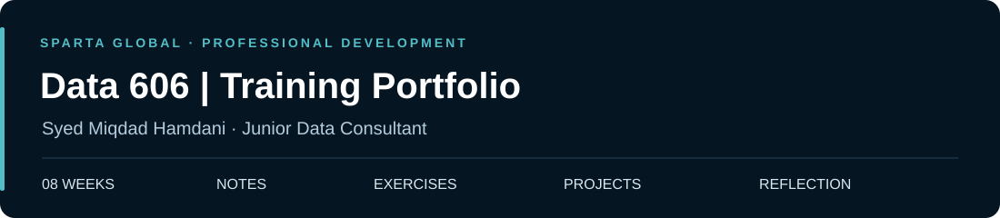

<p align="center">
  
</p>

# data-606-syed

**An eight-week record of professional learning and practical work at Sparta Global.**

I am a Junior Data Consultant at **Sparta Global**, undertaking an eight-week training programme in preparation for client deployment. This repository brings together my weekly notes, exercises, projects and reflections as I develop my consulting and data skills.

**Current stage: Week 4 of 8** · [Browse the weeks](#weekly-learning-record) · [Project portfolio](#project-portfolio) · [Reusable templates](templates/README.md)

> **Portfolio status:** [Week 1, Day 1](week-01/notes/day-01-professional-foundations.md) is documented, including the T-shaped professional discussion and a presentation brief. Further notes and practical evidence will be added as I document earlier training and continue the programme. Empty folders are placeholders, not completed work.

## Weekly learning record

Each week has its own overview and dedicated folders for notes, exercises and projects. Topics will be named as the actual training content is added.

| Week | Training stage | Documentation | Explore |
| :--- | :--- | :--- | :--- |
| [Week 01](week-01/README.md) | Earlier training | Day 1 added; remaining days to add | [Notes](week-01/notes/) · [Exercises](week-01/exercises/) · [Projects](week-01/projects/) |
| [Week 02](week-02/README.md) | Earlier training | To add | [Notes](week-02/notes/) · [Exercises](week-02/exercises/) · [Projects](week-02/projects/) |
| [Week 03](week-03/README.md) | Earlier training | To add | [Notes](week-03/notes/) · [Exercises](week-03/exercises/) · [Projects](week-03/projects/) |
| **[Week 04](week-04/README.md)** | **Current week** | **To add** | [Notes](week-04/notes/) · [Exercises](week-04/exercises/) · [Projects](week-04/projects/) |
| [Week 05](week-05/README.md) | Upcoming | Planned | [Notes](week-05/notes/) · [Exercises](week-05/exercises/) · [Projects](week-05/projects/) |
| [Week 06](week-06/README.md) | Upcoming | Planned | [Notes](week-06/notes/) · [Exercises](week-06/exercises/) · [Projects](week-06/projects/) |
| [Week 07](week-07/README.md) | Upcoming | Planned | [Notes](week-07/notes/) · [Exercises](week-07/exercises/) · [Projects](week-07/projects/) |
| [Week 08](week-08/README.md) | Upcoming | Planned | [Notes](week-08/notes/) · [Exercises](week-08/exercises/) · [Projects](week-08/projects/) |

## Project portfolio

Training projects will be highlighted here once their working files and documentation are available. Each entry will link to its brief, approach, validation and results inside the relevant week.

For work already available, visit the **[selected projects on my GitHub profile](https://github.com/miqyd0104#selected-projects)**.

## Repository structure

```text
data-606-syed/
├── README.md                 # Training overview and weekly navigation
├── week-01/                  # The same layout is used for weeks 01–08
│   ├── README.md             # Topics, evidence links and weekly reflection
│   ├── notes/                # Concepts, explanations and worked examples
│   ├── exercises/            # Practice tasks, solutions and checks
│   └── projects/             # Project files, results and documentation
├── week-02/ … week-08/
├── templates/                # Reusable note, exercise and project outlines
└── assets/                   # Shared portfolio visuals
```

## Adding work

1. Open the relevant week and copy an outline from [templates](templates/README.md) into its `notes/`, `exercises/` or `projects/` folder.
2. Use a descriptive name, such as `topic-name.md` for a note or `project-name/` for a project with several files.
3. Add the actual work, explain your approach and record how you checked the result. Link it from that week's overview.
4. Update the weekly reflection and the documentation status in the table above. As training progresses, update the current week here and on the profile.

For weeks 1–3, start with a topic list and the exercise files you already have, then fill in the explanations. Add a project to the portfolio section when it is ready to review.

## Evidence of development

As this portfolio grows, the work will show how I frame a problem, apply data techniques, validate outputs and explain findings. Reflections will capture feedback, challenges and the improvements I make from one week to the next.

---

**Syed Miqdad Hamdani** · Junior Data Consultant at Sparta Global

[GitHub profile](https://github.com/miqyd0104) · [LinkedIn](https://www.linkedin.com/in/syed-miqdad-hamdani/)
