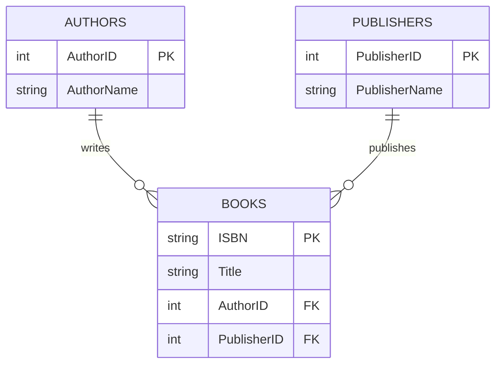

# Day 4 — Relational databases and SQL

1 October 2026

[← Week 2](../README.md) · [Day 3](day-03-git-and-github.md)

Today moved into relational databases and SQL. The morning covered tables, relationships and keys, followed by time on the SQL fundamentals course. In the afternoon we discussed data modelling, normalisation and data types, then went through the Northwind setup.

## Explaining previous experience

In the stand-up, I mentioned my MySQL project using a layoffs dataset for data cleaning and exploratory analysis. The feedback was to give that context straight away rather than just saying I had done some projects.

A short explanation should name the data, the tool and what I did with it. That gives someone enough information to ask a useful follow-up question.

SQL is relevant across analysis, engineering and other data work. The emphasis was on understanding the skill broadly, because work on a client assignment can extend beyond the wording of a job title.

## What is a database?

A database is an organised collection of data that can be stored, retrieved and updated. The value is not just keeping information somewhere; it is being able to find the right information when there is a lot of it.

A relational database stores data in tables with defined columns. Related tables can be connected through keys, allowing information to be brought together when needed.

For example, a books database could separate books, authors and publishers instead of repeating all the author and publisher details for every book.

### Tables, rows and columns

| Term | Meaning | Example |
| --- | --- | --- |
| Table | A collection of records with the same defined structure. | `Authors` |
| Row or record | One instance represented in the table. | One author's details |
| Column or attribute | A particular piece of information recorded for each row. | `AuthorName` |
| Schema | The structure and rules used to organise the database. | Tables, columns, data types and constraints |

The first design exercise was to identify consistent fields from information written on separate notes. Names, dates of birth, job roles and email addresses could become columns. Each person's information could become a row.

This is the starting point for modelling: work out what the data describes and which attributes belong together before creating tables.

## Database, DBMS and query tools

These terms are easy to mix up:

| Part | What it does |
| --- | --- |
| Database | Holds the organised data and database objects. Northwind is the example used in training. |
| Database management system (DBMS) | Manages storage, queries, changes and rules. Microsoft SQL Server is a relational DBMS. |
| Client or management tool | Connects to the DBMS so we can write queries and inspect results. Examples include SSMS and VS Code with a suitable extension. |
| SQL | The language used to work with the data and its structure. |

SSMS stands for **SQL Server Management Studio**. It is a tool for managing and interacting with SQL Server; it is separate from the database engine. See [Microsoft's SSMS overview](https://learn.microsoft.com/en-us/ssms/sql-server-management-studio-ssms).

I asked whether I should do the Northwind work in VS Code because I am on a Mac. The answer was yes: the interface looks different from the trainer's SSMS window, but the SQL is still sent to SQL Server.

The training setup for Mac users used SQL Server in a Docker container, with a separate editor connected to it. Installing an editor alone does not create a running database server.

## Relationships between tables

Relationships describe how records in one table relate to records in another. The rules depend on what the database needs to represent.

| Relationship | Meaning | Example |
| --- | --- | --- |
| One-to-one | A row on either side relates to at most one row on the other side. | A person and their single membership record in a particular organisation. |
| One-to-many | One row can be linked to several rows in another table. | One publisher publishing many books. |
| Many-to-many | Several rows on each side can relate to several rows on the other. | Actors appearing in many films, with each film featuring many actors. |

The relationship belongs to the connection between tables. A table can take part in more than one relationship.

### Primary keys

A **primary key** identifies each row uniquely within its table.

- Values must be unique and cannot be `NULL`.
- A table has at most one primary key constraint.
- That key can contain one column or several columns together.
- Choose a key that is stable, so related records do not need frequent changes.

A generated ID is a common choice. A value already present in the data can also be used, but it must actually meet the uniqueness and stability requirements. A person's name is not enough: different people can have the same name.

A **composite key** uses a combination of columns. For example, an order number and a line number can identify a particular line within an order. The combination must be unique even though either column can repeat on its own.

### Foreign keys

A **foreign key** references a key in a related table. In the books example, `Books.PublisherID` points to `Publishers.PublisherID`.

This lets each book refer to a publisher without repeating that publisher's full details. Several books can contain the same publisher ID, so foreign key values do not have to be unique.

The foreign key constraint enforces **referential integrity**: a non-null reference must match an existing referenced key. A foreign key can reference a primary key or another suitable unique key.

Deleting a referenced row depends on the constraint's rules. With the usual `NO ACTION` behaviour, SQL Server rejects a deletion that would leave broken references. Other rules, such as cascading deletes, can be configured. See [Microsoft's guide to key constraints](https://learn.microsoft.com/en-us/sql/relational-databases/tables/primary-and-foreign-key-constraints).

### Books example

A simplified design from the discussion was:



Here, ISBN identifies a row in `Books`. Author and publisher IDs connect it to the other tables. The diagram assumes one author and one publisher per book record; a design that supports co-authored books needs a many-to-many relationship for books and authors.

For that relationship, a **bridge table**, also called a junction table, can hold pairs of book IDs and author IDs. Each row records one association, instead of trying to fit several author IDs into a single field.

## Data modelling and ERDs

Data modelling means deciding how data should be organised, what each part represents and how the parts relate. The comparison was planning a house before building it: changing the structure afterwards is much harder.

An **entity** is something we collect data about, such as a customer, book, author or order. An entity type is commonly represented by a table, with each row representing an instance.

Start by asking:

- What things do we need to record?
- Which attributes describe each one?
- How can each record be identified?
- What relationships and rules need to be enforced?

An **ERD**, or **entity relationship diagram**, makes that design visible. It shows tables or entities, their attributes, keys and relationships. Crow's foot notation helps show whether a relationship allows one or many records.

Tables can serve different purposes. Some hold details about business entities, while others store associations, reference values or supporting information. The structure should follow the requirements rather than forcing every table into the same pattern.

The discussion introduced ERDs rather than working through a complete modelling exercise. Northwind will also give us an existing design to explore and understand through queries.

## Normalisation

**Normalisation** organises data to reduce unnecessary duplication and avoid inconsistent dependencies.

If an author's contact details are copied into every book row, a change might require many updates. Missing one copy leaves conflicting information. Keeping the author details in one place and referencing them from books makes that easier to maintain.

The aim is not to remove every repeated value. Repeated foreign key values are expected in a one-to-many relationship. The problem is repeatedly storing facts that should be maintained in one place.

First, second and third normal form were introduced. Third normal form was suggested as a common target, but the detailed rules were left for later. Normal forms are about how attributes depend on keys, not simply how many tables there are. [Microsoft's normalisation explanation](https://learn.microsoft.com/en-us/office/troubleshoot/access/database-normalization-description) gives examples of the underlying problems.

There is a trade-off to consider. Separating data can improve consistency and reduce redundant storage, but queries may need more joins. More normalisation does not automatically make every query faster.

## SQL Server data types

A column's data type determines the kind of values it can hold and affects storage and operations.

| Type | Use |
| --- | --- |
| `INT` | Whole numbers. |
| `CHAR(n)` | Character data with a fixed storage length. |
| `VARCHAR(n)` | Character data with a variable storage length, up to a specified limit. |
| `DATE` | A calendar date. |
| `TIME` | A time of day. |
| `DATETIME` / `DATETIME2` | A date and time together. |
| `DECIMAL(p, s)` | Exact decimal values with a defined precision and scale. |
| `FLOAT` / `REAL` | Approximate numeric values. |
| `BIT` | `0`, `1`, or `NULL` where the column permits nulls. |
| `BINARY` / `VARBINARY` | Binary data, such as file contents. |

The [SQL Server data type list](https://learn.microsoft.com/en-us/sql/t-sql/data-types/data-types-transact-sql) is useful when checking the exact type names available in T-SQL.

### Decimal and float are different

`DECIMAL` and `FLOAT` are both numeric types, but they are not interchangeable names.

For `DECIMAL(10, 2)`, precision is ten digits in total and scale is two digits after the decimal point. `FLOAT` stores approximate values, so it is unsuitable when exact decimal behaviour is required. See Microsoft's explanations of [decimal precision and scale](https://learn.microsoft.com/en-us/sql/t-sql/data-types/decimal-and-numeric-transact-sql) and [floating-point values](https://learn.microsoft.com/en-us/sql/t-sql/data-types/float-and-real-transact-sql?view=sql-server-ver17).

### Bit and binary data

`BIT` can store Boolean-style flags, such as whether a record is active. It is separate from binary file storage. [Microsoft's `BIT` documentation](https://learn.microsoft.com/en-us/sql/t-sql/data-types/bit-transact-sql?view=sql-server-ver17) confirms the possible values and Boolean usage.

**BLOB** means binary large object. It describes data such as images or documents; it is not the name of a SQL Server column type. SQL Server can store binary content using types such as `VARBINARY(MAX)`.

`ENUM` also came up in the discussion. Type names vary between database systems, so a type used in MySQL should not be assumed to exist in SQL Server. SQL Server does not have a built-in `ENUM` type; a restricted set of values can instead be represented using constraints or a related lookup table.

## CRUD and SQL fundamentals

**CRUD** means **Create, Read, Update, Delete**. It describes the basic operations to learn when working with a data storage system.

| Operation on records | SQL statement |
| --- | --- |
| Create new records | `INSERT` |
| Read existing records | `SELECT` |
| Update existing records | `UPDATE` |
| Delete records | `DELETE` |

Creating the database or its tables is a separate structural operation, using statements such as `CREATE DATABASE` and `CREATE TABLE`.

The fundamentals course covered database and table creation, inserting data, constraints, keys and updates. The recommendation was to follow along with a working connection rather than only watch the videos.

SQL Server uses **T-SQL**, Microsoft's SQL dialect. A fuller comparison with MySQL was deferred, so the main point for now is to check syntax against the database system being used.

## Setting up Northwind

Northwind is a sample trading-company database containing customers, orders, products, employees and suppliers. It has enough related data for practising filters, joins and aggregations.

The afternoon demo used the Northwind script supplied for the course. That version populated an existing database, so the database had to be created and selected first.

### Create an empty database

For a fresh setup where `Northwind` does not already exist:

```sql
CREATE DATABASE Northwind;
GO
```

Then select it before running the supplied table-and-data script:

```sql
USE Northwind;
GO
```

Paste the supplied setup script after those lines. It creates the tables, defines relationships and inserts the sample data.

Check the database context before executing. Running a script in the wrong context can create objects in the wrong database, such as `master`. Different Northwind scripts may handle database creation themselves, so read the beginning of the script being used.

The semicolon ends a SQL statement. `GO` is a batch separator recognised by tools such as SSMS; it is not itself a T-SQL statement sent to the database engine. See [Microsoft's explanation of `GO`](https://learn.microsoft.com/en-us/sql/t-sql/language-elements/sql-server-utilities-statements-go).

### Check that the data is available

The basic check shown was:

```sql
USE Northwind;
GO

SELECT *
FROM Customers;
```

Returned customer rows show that the connection, database selection and customer data are available. The demo used `Northwind2` because the trainer already had another copy; the name in `USE` must match the database created locally.

For the container setup, stopping and deleting a container are different actions. Data kept only inside a container is lost when that container is removed; persistent volumes can keep database files outside its lifecycle. See [Microsoft's container storage guidance](https://learn.microsoft.com/en-us/sql/linux/containers/configure?view=sql-server-ver17).

## Keeping useful queries

The recommendation was to keep queries with a short explanation of what they answer. Markdown code blocks with `sql` after the opening fence make examples easier to read.

One example shown was finding customers based in Paris:

```sql
SELECT *
FROM Customers
WHERE City = 'Paris';
```

`SELECT *` requests all columns, `FROM` names the table and `WHERE` filters the rows. Text values use single quotes.

Saving examples this way keeps the question beside the query. Reusable scripts can also be saved as `.sql` files.

## Practice for the next session

The main task was to finish the SQL fundamentals material and prepare Northwind for querying. Basic Northwind questions were available as optional practice, with join exercises for anyone ready to go further.

The fuller querying session was moved to the following morning. Joins, subqueries, aggregation, stored procedures and indexing were upcoming topics rather than topics completed today.
