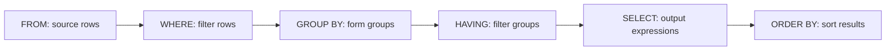

# Day 5 — SQL querying

2 October 2026

[← Week 2](../README.md) · [Day 4](day-04-relational-databases-and-sql.md)

The morning started with more “tell me about yourself” practice, then moved into querying Northwind. We covered selecting and filtering data, calculations, sorting, aggregation and missing values. Joins were left for the next session.

## Interview introductions

The feedback on the introductions was useful beyond the people presenting:

- Start with a short introduction instead of jumping straight into a list of jobs.
- Explain the reasons behind a career choice or move into data. The path does not have to be perfectly straight, but the reasoning should be clear.
- Give specific examples of projects and experience, with enough context to make them understandable.
- Leave room for follow-up questions rather than explaining every detail immediately.
- Practise speaking in your own words so it sounds like a conversation, rather than reading out a CV.
- Include relevant experience outside technology. It can still demonstrate communication, responsibility and problem solving.
- Tailor the ending to the role and organisation, then hand the conversation back clearly.

Around 90 seconds was the trainer's preference, rather than a fixed rule. Clear delivery, interest in the subject and a coherent story mattered more than hitting an exact time.

## SQL and different database systems

**SQL** stands for **Structured Query Language**. SQL Server, MySQL and PostgreSQL are database systems; SQL is the language used to interact with them.

SQL Server uses **T-SQL**, or **Transact-SQL**. The main ideas transfer between systems, but some syntax differs.

| Task | SQL Server / T-SQL | MySQL |
| --- | --- | --- |
| Limit the number of rows returned | `SELECT TOP (10) ...` | `SELECT ... LIMIT 10` |
| Delimit a table name containing a space | `[Order Details]` | `` `Order Details` `` |
| Generate incrementing values | `IDENTITY(1, 1)` | `AUTO_INCREMENT` |
| Call a stored procedure | `EXEC ProcedureName` | `CALL ProcedureName()` |

Square brackets and backticks in this context are for **identifiers**, such as table names. Text values use single quotes, such as `'London'`. They serve different purposes. See the [MySQL identifier rules](https://dev.mysql.com/doc/refman/8.4/en/identifiers.html).

Date formatting and pattern matching can also differ, so examples need to match the database system being used. All queries below use T-SQL and the course's Northwind database.

## Start with the right database

The trainer used VS Code for the demo after having performance problems with SSMS. Both are ways of connecting to SQL Server; the query concepts are the same.

```sql
USE Northwind;
GO

SELECT *
FROM Customers;
```

`USE Northwind` selects the database for the connection. Check the database context when opening another query window or changing connections.

`SELECT *` returns all columns. With no filter here, it also returns all customer rows. It is useful for initially inspecting a small training table, but selecting only the columns needed makes a query's purpose clearer and avoids returning unnecessary data.

## Selecting columns and filtering rows

`SELECT` controls the columns or expressions returned. `FROM` identifies the source table. `WHERE` filters individual rows.

Find customers in British Columbia:

```sql
SELECT CompanyName, City, Country, Region
FROM Customers
WHERE Region = 'BC';
```

Find products with stock available:

```sql
SELECT ProductName, UnitsInStock
FROM Products
WHERE UnitsInStock > 0;
```

Use single quotes around text values. Numeric values such as `0` do not need them. Before writing a condition, check the actual column name and the values stored in it rather than guessing.

## Written order and logical processing order

The main clauses are written in this order:

```text
SELECT → FROM → WHERE → GROUP BY → HAVING → ORDER BY
```

For the clauses covered today, the logical processing order is:



This explains which values are available to each clause. It is not a promise that the engine physically reads every row in that sequence; the optimiser decides how to execute the query. `DISTINCT` and `TOP` add further logical steps when used. See [Microsoft's SELECT processing explanation](https://learn.microsoft.com/en-us/sql/t-sql/queries/select-transact-sql).

## Aliases and COUNT

An **alias** gives a column or expression a useful name in the result. It does not rename the stored column or create a permanent table.

```sql
SELECT COUNT(*) AS NumberOfCustomers
FROM Customers
WHERE City = 'Paris';
```

This returns a count of matching customer rows, with `NumberOfCustomers` as the output heading. The classroom example returned two.

### What goes inside COUNT?

This came up as a question during the demo:

| Expression | What it counts |
| --- | --- |
| `COUNT(*)` | Every row, including rows containing null values. |
| `COUNT(Region)` | Rows where `Region` is not null. |
| `COUNT(DISTINCT Region)` | Different non-null region values. |
| `COUNT(1)` | Every row, because the constant `1` is non-null for every row. |

`COUNT(1)` does not mean count column one. The difference between counting rows and counting non-null values matters when a column has missing data. See [Microsoft's COUNT documentation](https://learn.microsoft.com/en-us/sql/t-sql/functions/count-transact-sql).

## Queries from the class exercises

These were the three short tasks discussed during the lesson.

### Count employees based in London

```sql
SELECT COUNT(*) AS EmployeesInLondon
FROM Employees
WHERE City = 'London';
```

### Find employees with the title Dr.

```sql
SELECT FirstName, LastName, TitleOfCourtesy
FROM Employees
WHERE TitleOfCourtesy = 'Dr.';
```

The spelling and punctuation need to match the stored value. The example returned Andrew Fuller.

### Count discontinued products

```sql
SELECT COUNT(*) AS DiscontinuedProducts
FROM Products
WHERE Discontinued = 1;
```

The demo returned eight. `Discontinued` is a flag: `1` means true and `0` means false in this table. These results describe the training dataset and can change if the data is edited.

## Quotes and apostrophes

Text literals use single quotes. To include an apostrophe inside the text, double it:

```sql
SELECT 'O''Brien' AS ExampleName;
```

The result is `O'Brien`. The same escaping applies inside a `WHERE` condition, such as when matching an address containing an apostrophe.

Date and time literals also use quotes. Numbers and bit values normally do not. Binary literals have a separate hexadecimal form, such as `0xABCD`; they should not be treated as ordinary quoted text.

## Comparison and logical operators

| Operator | Meaning | Example condition |
| --- | --- | --- |
| `=` | Equal to | `City = 'London'` |
| `<>` or `!=` | Not equal to | `Country <> 'UK'` |
| `>` / `<` | Greater than / less than | `UnitsInStock > 0` |
| `>=` / `<=` | Greater than or equal / less than or equal | `UnitPrice >= 10` |
| `AND` | Both conditions must be true | `Country = 'UK' AND City = 'London'` |
| `OR` | At least one condition must be true | `City = 'London' OR City = 'Paris'` |
| `IN` | Matches a value in a list | `Region IN ('WA', 'BC')` |
| `BETWEEN` | Within an inclusive range | `UnitPrice BETWEEN 10 AND 20` |
| `NOT` | Negates a condition | `NOT (Country = 'UK')` |

`NOT` is not limited to text and `!=` is not limited to numbers. `NOT (Country = 'UK')` and `Country <> 'UK'` express the same exclusion here. `NOT` can also combine with other conditions, for example `Country NOT IN ('UK', 'France')`. See [Microsoft's NOT explanation](https://learn.microsoft.com/en-us/sql/t-sql/language-elements/not-transact-sql?view=sql-server-ver17).

Use parentheses when mixing `AND` and `OR` to make the intended grouping clear. Nulls need separate handling: a missing country does not automatically count as a country outside the UK.

## DISTINCT

`DISTINCT` removes duplicate combinations from the selected output.

```sql
SELECT DISTINCT Country
FROM Customers
WHERE ContactTitle = 'Owner';
```

This lists each country represented by those customer records once. It does not delete duplicate data from the table.

If the query selects both `Country` and `City`, uniqueness applies to the pair. A country can then appear more than once if it has customers in different cities.

## TOP and ORDER BY

`TOP` limits how many rows are returned in T-SQL. `ORDER BY` determines the order, and therefore which rows qualify as the first ten:

```sql
SELECT TOP (10) CompanyName, City
FROM Customers
WHERE Country = 'France'
ORDER BY CompanyName DESC, CustomerID ASC;
```

`ASC` is ascending order and is the default. `DESC` reverses the order. A second sort column can resolve ties; `CustomerID` is used here for that purpose.

Without `ORDER BY`, there is no guaranteed result order, so `TOP (10)` does not reliably identify a particular set of ten records. It also cannot return ten matches if fewer than ten exist. See [Microsoft's TOP guidance](https://learn.microsoft.com/en-us/sql/t-sql/queries/top-transact-sql).

MySQL places `LIMIT 10` later in the query instead of using `TOP`. See its [SELECT syntax](https://dev.mysql.com/doc/refman/8.4/en/select.html).

Prefer sorting by a column name or alias over a position such as `ORDER BY 4`. Changing the selected columns can silently change what that number refers to.

## LIKE and wildcards

`LIKE` matches text patterns:

| Pattern | Meaning |
| --- | --- |
| `'Ch%'` | Starts with `Ch`, followed by zero or more characters. |
| `'%Ch%'` | Contains `Ch` somewhere. |
| `'_h%'` | Has any single character first, then `h`, then any remaining characters. |
| `'[ABC]%'` | Starts with one of the listed characters. |
| `'[^ABC]%'` | Starts with a character outside the listed set. |

The square-bracket patterns shown here are T-SQL syntax. See [Microsoft's LIKE documentation](https://learn.microsoft.com/en-us/sql/t-sql/language-elements/like-transact-sql).

```sql
SELECT ProductName
FROM Products
WHERE ProductName LIKE 'Ch%';
```

The demo returned names such as Chai and Chang.

### Case sensitivity

Whether `'Ch%'` and `'ch%'` match the same names depends on the **collation** used for the comparison. A case-insensitive collation treats upper and lower case as equivalent; a case-sensitive one distinguishes them. It is a configured comparison rule, not SQL guessing the intended text. See [Microsoft's collation guide](https://learn.microsoft.com/en-us/sql/relational-databases/collations/collation-and-unicode-support).

## Concatenating text

`CONCAT` combines values into one output string:

```sql
SELECT
    CompanyName,
    CONCAT(City, ', ', Country) AS Location
FROM Customers;
```

The quoted `', '` is the comma and space placed between the city and country. The other commas separate function arguments. This creates a readable result such as `Berlin, Germany` without changing the stored columns.

## Calculations in a query

SQL supports addition (`+`), subtraction (`-`), multiplication (`*`), division (`/`) and modulo (`%`). Modulo gives the remainder: `5 % 2` is `1`.

In a `LIKE` pattern, `%` is a wildcard. In an arithmetic expression, it is the modulo operator. The context matters.

The order-line example calculated the value before discount:

```sql
SELECT
    UnitPrice,
    Quantity,
    Discount,
    UnitPrice * Quantity AS GrossTotal
FROM [Order Details]
ORDER BY GrossTotal DESC;
```

`[Order Details]` needs brackets because its name contains a space. `GrossTotal` is a calculated output value, not an existing stored column. Although `Discount` is displayed, it has not been applied in this calculation.

The alias works in `ORDER BY` because that clause comes after `SELECT` in logical processing. In the same query block, it cannot be used as a newly defined alias in `WHERE` or `HAVING`.

## Aggregate functions

Aggregates summarise several rows into a value for the whole input or for each group.

| Function | Purpose |
| --- | --- |
| `COUNT` | Count rows or non-null values. |
| `SUM` | Add values together. |
| `AVG` | Calculate the average. |
| `MIN` | Find the smallest value. |
| `MAX` | Find the largest value. |

The demo summarised the products table:

```sql
SELECT
    COUNT(*) AS TotalProducts,
    SUM(UnitsOnOrder) AS TotalUnitsOnOrder,
    AVG(UnitsOnOrder) AS AverageUnitsOnOrder,
    MIN(UnitsOnOrder) AS MinimumUnitsOnOrder,
    MAX(UnitsOnOrder) AS MaximumUnitsOnOrder
FROM Products;
```

With no grouping, this returns one summary row. `SUM`, `AVG`, `MIN` and `MAX` ignore null input values; `COUNT(*)` still counts rows containing nulls.

### Keep the data type in mind with AVG

In SQL Server, `AVG` over an integer column returns an integer result. To keep a fractional average for a column such as `UnitsOnOrder`, convert the input to a decimal:

```sql
SELECT AVG(CAST(UnitsOnOrder AS DECIMAL(10, 2))) AS AverageUnitsOnOrder
FROM Products;
```

This avoids interpreting a truncated integer result as the exact average. See [Microsoft's AVG return types](https://learn.microsoft.com/en-us/sql/t-sql/functions/avg-transact-sql).

## GROUP BY and HAVING

`GROUP BY` divides rows into groups so the aggregates can be calculated separately. Grouping by supplier changes a total for all products into a total for each supplier.

```sql
SELECT
    SupplierID,
    COUNT(*) AS TotalProducts,
    SUM(UnitsOnOrder) AS TotalUnitsOnOrder,
    AVG(CAST(UnitsOnOrder AS DECIMAL(10, 2))) AS AverageUnitsOnOrder
FROM Products
GROUP BY SupplierID
HAVING AVG(CAST(UnitsOnOrder AS DECIMAL(10, 2))) > 5
ORDER BY AverageUnitsOnOrder DESC;
```

Including `SupplierID` in the output makes it clear which group each row describes. `HAVING` keeps only groups whose average is greater than five.

For these grouped queries, selected columns must be grouped or used inside an aggregate. Otherwise, SQL Server would have no single value to return for an ungrouped column within each group.

### WHERE and HAVING can be used together

The distinction is **rows before grouping** versus **groups after aggregation**. Having a `GROUP BY` does not prevent a query from also using `WHERE`.

For example, filter out discontinued products first, then keep suppliers with more than two remaining products:

```sql
SELECT SupplierID, COUNT(*) AS ActiveProducts
FROM Products
WHERE Discontinued = 0
GROUP BY SupplierID
HAVING COUNT(*) > 2
ORDER BY ActiveProducts DESC;
```

`WHERE` changes which rows enter the calculation. `HAVING` tests the resulting groups. The aggregate expression is repeated in `HAVING` because the `SELECT` alias is not available there yet.

`HAVING` can also be used without an explicit `GROUP BY`: SQL Server treats the input as a single aggregate group. For example:

```sql
SELECT COUNT(*) AS TotalProducts
FROM Products
HAVING COUNT(*) > 50;
```

This returns the summary row only if its count exceeds fifty. See [Microsoft's HAVING documentation](https://learn.microsoft.com/en-us/sql/t-sql/queries/select-having-transact-sql).

## Missing values: NULL

`NULL` represents a missing or unknown value. It is different from zero and from an empty string.

Find customers with no region recorded:

```sql
SELECT CompanyName
FROM Customers
WHERE Region IS NULL;
```

Find those with a region recorded:

```sql
SELECT CompanyName, Region
FROM Customers
WHERE Region IS NOT NULL;
```

Use `IS NULL` and `IS NOT NULL`, rather than `= NULL` or `!= NULL`. Ordinary comparisons with null produce an unknown result, which does not pass a `WHERE` filter.

The classroom data had many missing regions. That is a reason to investigate the field and its meaning before cleaning it, rather than automatically treating missing values as zero or filling them with guesses.

## Further practice

The next topic was joins, followed by more work on subqueries, aggregation, stored procedures, indexing and query efficiency. These remained topics for later sessions.

One optional project idea discussed was to choose a dataset, identify its entities, draw an ERD, build the tables and load the data, then query it. That would bring the database design and querying work together.

The afternoon was allocated to separate AI training.
