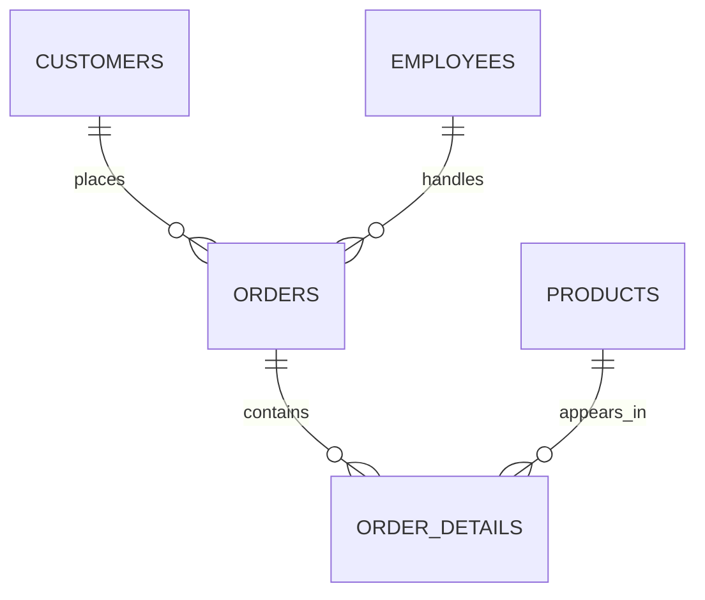

# Day 1 — SQL joins

5 October 2026

[← Week 3](../README.md) · [Previous notes: SQL querying](../../week-02/notes/day-05-sql-querying.md)

Today focused on joins: combining related tables, deciding which records to keep and using the results for analysis. We started with small users-and-orders examples, then worked through Northwind queries in the afternoon. There was also feedback on dashboards and interview answers.

## What makes a dashboard useful?

The dashboard review was a reminder that the purpose is to communicate insights, not just display charts.

- Put the main KPIs somewhere prominent, usually near the top, so the reader gets an overview straight away.
- Give numbers context. A percentage needs a label that explains what it measures, and a survey total is more useful when the scope is clear.
- Use chart titles to state the key finding. A title such as “More experience is associated with higher pay” tells the reader more than simply naming the two axes.
- Add short explanations where they help someone understand the result without needing a presentation alongside it.
- Keep colours, spacing and layout consistent. A heatmap also needs a clear scale: the colours should make high and low values easy to distinguish.
- Avoid overcrowding a chart. If showing only the top categories, make that selection clear and provide a way to explore the rest where useful.
- Use filters or slicers when they help the audience ask questions of the data.

A useful check is whether someone could read the dashboard, understand the main findings and use them in a meeting without needing the author to explain every chart.

The review also discussed being open about using AI tools. The emphasis was on understanding and checking the output, using it thoughtfully and explaining the help received. The finished work still needs to be accurate and appropriate for its audience.

## My interview practice: motivation

I answered a question about what motivates me. I talked about seeing progress, learning new things, solving problems in data and taking on challenges rather than avoiding them.

The positive feedback was that I answered the question directly and kept it concise. I also started with a general answer before connecting it to data.

The main things to improve were:

- **Projection:** speak more clearly and with enough energy for the answer to sound convincing.
- **Evidence:** add a real example of solving a problem or working through a challenge, rather than only saying that these things motivate me.
- **Ending:** finish the answer clearly instead of letting it trail off.

A short STAR example could support the answer where it fits. The point is to give evidence for the claim, while still answering the original question.

The wider interview feedback was to explain technical concepts without assuming the listener already knows every term. For example, comparing Agile with Waterfall only helps if the difference is explained. Being comfortable discussing my current understanding matters; I do not need to pretend to know everything.

## What is a join, and why use one?

A **join** combines rows from tables into a result set using a matching condition. The join type controls what happens when a row has no match.

Relational databases separate related information into tables. In Northwind, customer names are in `Customers`, order headers are in `Orders`, and the products within each order are in `[Order Details]`. A join lets us bring those facts together to answer a question.

For example:

- Which customers placed which orders?
- Which products were included in an order?
- What was the total value of an order?
- Which customers have never ordered?

A normal `SELECT` with joins returns a result set. It does not merge the stored tables or automatically create a permanent or temporary table.

### The matching condition

```sql
SELECT c.CompanyName, o.OrderID, o.OrderDate
FROM Customers AS c
INNER JOIN Orders AS o
    ON c.CustomerID = o.CustomerID;
```

The `ON` clause says how to match rows. Here, an order belongs to a customer when its `CustomerID` matches that customer's ID.

Primary and foreign keys make the intended relationships easier to identify, and foreign key constraints protect those relationships. However, a join does not require an existing foreign key constraint. The joined columns do not even need identical names; they need a meaningful comparison. See [Microsoft's join fundamentals](https://learn.microsoft.com/en-us/sql/relational-databases/performance/joins).

### Table aliases

`c` and `o` are aliases for `Customers` and `Orders`. They make the query shorter and show which table supplies each column.

`c.CustomerID` and `o.CustomerID` are different column references, even though the column names match. Qualifying them avoids ambiguity.

An alias is a name used within the query, not a new database or a copy of the table. Clear aliases are especially useful when several tables are involved.

## Comparing the join types

For a simple `FROM A ... JOIN B` expression, `A` is the left input and `B` is the right input.

| Join | Rows kept in the joined result |
| --- | --- |
| `INNER JOIN` | Matching pairs from both sides. Unmatched rows are excluded. |
| `LEFT JOIN` | Every left-side row, plus matching right-side rows. Missing right-side values become null. |
| `RIGHT JOIN` | Every right-side row, plus matching left-side rows. Missing left-side values become null. |
| `FULL OUTER JOIN` | Matching pairs, plus unmatched rows from either side. Missing values on the other side become null. |

`JOIN` alone means `INNER JOIN` in T-SQL. `OUTER` is optional in `LEFT OUTER JOIN`, `RIGHT OUTER JOIN` and `FULL OUTER JOIN`. See [Microsoft's join syntax](https://learn.microsoft.com/en-us/sql/t-sql/queries/from-transact-sql).

These describe the join result before any later filtering. A `WHERE` clause can still remove rows.

### A small example

Using the same idea as the lesson, suppose these are the users:

| UserID | Name |
| --- | --- |
| 1 | Alice |
| 2 | Bob |
| 3 | Charlie |

And these are their orders:

| OrderID | UserID |
| --- | --- |
| 101 | 1 |
| 102 | 1 |
| 103 | 2 |

An inner join returns Alice's two orders and Bob's one order:

```sql
SELECT u.Name, o.OrderID
FROM Users AS u
INNER JOIN Orders AS o
    ON u.UserID = o.UserID;
```

| Name | OrderID |
| --- | --- |
| Alice | 101 |
| Alice | 102 |
| Bob | 103 |

Charlie is missing because there is no matching order. Alice appears twice because she has two matches. Joins do not automatically remove repeated values.

Changing the join to `LEFT JOIN` also returns Charlie:

```sql
SELECT u.Name, o.OrderID
FROM Users AS u
LEFT JOIN Orders AS o
    ON u.UserID = o.UserID;
```

| Name | OrderID |
| --- | --- |
| Alice | 101 |
| Alice | 102 |
| Bob | 103 |
| Charlie | NULL |

These tables illustrate the rows returned; without `ORDER BY`, their display order is not guaranteed.

### Right and full joins

```sql
SELECT u.Name, o.OrderID
FROM Users AS u
RIGHT JOIN Orders AS o
    ON u.UserID = o.UserID;
```

This preserves all orders. In the small dataset above, every order has a matching user, so it returns the same pairs as the inner join.

The lesson also considered an extra order with `UserID = 999`, where that user does not exist. A right join would keep that order and return null for the user's name. Such an orphaned reference would be rejected by an enforced foreign key, so this example assumes that constraint is absent or not enforced.

```sql
SELECT u.Name, o.OrderID
FROM Users AS u
FULL OUTER JOIN Orders AS o
    ON u.UserID = o.UserID;
```

A full join would preserve both Charlie without an order and the unmatched order without a user. It does not pair every user with every order; matched rows still follow the `ON` condition.

A right join can be rewritten as a left join by swapping the inputs. The recommendation was to keep a consistent direction where possible so queries are easier to read:

```sql
SELECT u.Name, o.OrderID
FROM Orders AS o
LEFT JOIN Users AS u
    ON u.UserID = o.UserID;
```

## Understanding Northwind before joining it

Before building a query, inspect the tables, columns and keys. An Object Explorer, database diagram or small sample query can help. Similar column names are a clue, but they are not enough on their own to prove a relationship.

The main relationships used today were:



This is a simplified map of the join paths used in the examples.

| Table | Information needed for today's queries |
| --- | --- |
| `Customers` | Customer ID and company name. |
| `Orders` | Order ID, customer ID, employee ID and order date. |
| `[Order Details]` | Order ID, product ID, quantity, sale unit price and discount. |
| `Products` | Product ID and product name. |
| `Employees` | Employee ID, first name and last name. |

`Orders` describes an order as a whole. `[Order Details]` describes its individual product lines. They serve different purposes and cannot always replace one another.

### The junction table

An order can contain several products, and a product can appear in several orders. This is a many-to-many relationship.

`[Order Details]` acts as a **junction table**, also called a **bridge table**. It connects an order to a product and records information about that association, including the quantity and price.

The standard Northwind design uses `OrderID` and `ProductID` together as its primary key. Both also reference their corresponding tables. The structure can be checked in [Microsoft's Northwind setup script](https://github.com/microsoft/sql-server-samples/blob/master/samples/databases/northwind-pubs/instnwnd.sql).

## Orders with product names

The join path is `Orders → Order Details → Products`:

```sql
SELECT o.OrderID, p.ProductName, od.Quantity
FROM Orders AS o
INNER JOIN [Order Details] AS od
    ON o.OrderID = od.OrderID
INNER JOIN Products AS p
    ON od.ProductID = p.ProductID;
```

The first join finds each order's product lines. The second adds the product names.

The result is at **order-line level**, so an order containing three products appears on three rows. Seeing the same order ID more than once is expected here, not necessarily a duplicate-data problem.

The brackets around `[Order Details]` are required because the table name contains a space.

## Total value of each order

Multiply quantity by the unit price on each order line, then add the line values together:

```sql
SELECT
    o.OrderID,
    SUM(od.Quantity * od.UnitPrice) AS GrossOrderTotal
FROM Orders AS o
INNER JOIN [Order Details] AS od
    ON o.OrderID = od.OrderID
GROUP BY o.OrderID;
```

`SUM` adds the line values, while `GROUP BY o.OrderID` makes a separate total for each order. Use the price recorded on the order line, rather than assuming the current product price is the historical sale price.

The example is a **gross total before discounts**, and it does not include freight. The lesson's calculation did not apply the `Discount` field, so it should not be described as a final invoice amount.

Removing `GROUP BY` while still selecting `o.OrderID` causes an error in SQL Server. To calculate one grand total instead, also remove the unaggregated order ID from `SELECT`.

## Customer spend

To connect customer names to order-line values, the path is `Customers → Orders → Order Details`:

```sql
SELECT
    c.CustomerID,
    c.CompanyName,
    SUM(od.Quantity * od.UnitPrice) AS GrossSpend
FROM Customers AS c
INNER JOIN Orders AS o
    ON c.CustomerID = o.CustomerID
INNER JOIN [Order Details] AS od
    ON o.OrderID = od.OrderID
GROUP BY c.CustomerID, c.CompanyName
ORDER BY GrossSpend DESC;
```

This brings together joins, aggregation, grouping and sorting. Each row represents a customer with matching order lines, and the highest gross spend appears first.

Grouping by the customer ID as well as the name keeps different customers separate even if their names happen to match.

Customers without orders will not appear because these are inner joins. Their absence does not prove that every customer in the database has ordered. A customer with matching order lines could also have a calculated total of zero; a match and a positive amount are separate conditions.

## Customers with no orders

Keep all customers, then look for those with no matching order:

```sql
SELECT c.CustomerID, c.CompanyName
FROM Customers AS c
LEFT JOIN Orders AS o
    ON c.CustomerID = o.CustomerID
WHERE o.OrderID IS NULL;
```

`OrderID` is non-null for a real order. A null on the right side therefore identifies an unmatched customer in this result.

The classroom example returned two companies. That result depends on the data loaded; it is not a fixed property of the query.

Use `IS NULL`, not `= NULL`. A null produced by an outer join means that no row matched on that side; it does not mean a blank order was stored in the database.

## Products that have never been ordered

The same pattern works for products:

```sql
SELECT p.ProductID, p.ProductName
FROM Products AS p
LEFT JOIN [Order Details] AS od
    ON p.ProductID = od.ProductID
WHERE od.ProductID IS NULL;
```

This preserves all products, then finds those with no order-line reference. The demo returned no rows. An empty result can be a valid answer, so check both the query logic and the underlying data before assuming something is broken.

## Orders, customers and employees together

Not every three-table query goes through a junction table. Here, `Orders` links directly to both customers and employees:

```sql
SELECT
    o.OrderID,
    c.CompanyName,
    CONCAT(e.FirstName, ' ', e.LastName) AS EmployeeName
FROM Orders AS o
INNER JOIN Customers AS c
    ON o.CustomerID = c.CustomerID
INNER JOIN Employees AS e
    ON o.EmployeeID = e.EmployeeID;
```

The result shows an order, the customer who placed it and the employee associated with it. `CONCAT` combines the employee's first and last names with a space.

The discussion described this as looking at the order from several perspectives. It helps explain how one central transaction can connect to several descriptive tables, without requiring Northwind to be treated as a purpose-built dimensional warehouse.

## Number of orders handled by each employee

```sql
SELECT
    e.EmployeeID,
    CONCAT(e.FirstName, ' ', e.LastName) AS EmployeeName,
    COUNT(o.OrderID) AS NumberOfOrders
FROM Employees AS e
INNER JOIN Orders AS o
    ON e.EmployeeID = o.EmployeeID
GROUP BY e.EmployeeID, e.FirstName, e.LastName
ORDER BY NumberOfOrders DESC;
```

This counts orders per employee. The employee ID keeps people with identical names separate.

With the inner join, only employees with matching orders appear. To include employees with no orders, change it to a left join and keep `COUNT(o.OrderID)`. Using `COUNT(*)` in that version would count the preserved unmatched row and incorrectly show one order.

Order count is one measure of activity. It does not, by itself, establish overall employee performance or account for different workloads and order complexity.

## Checks when building joins

Start with the question and decide what one output row should represent: an order line, an order, a customer or an employee. Then choose the tables and relationships needed.

Things to watch for:

- A one-to-many join can increase the number of rows. Check that increase before calculating totals.
- Join on the intended keys. Matching on names can mix unrelated records or create extra matches.
- Only select the columns needed, and qualify them with table aliases.
- Choose the join type according to which unmatched records must remain visible.
- Be careful with filters after a left join. A condition such as `WHERE o.OrderDate >= '20200101'` excludes null order dates, removing customers without matching orders. Put the date condition in `ON` if the aim is to keep every customer while matching only qualifying orders.
- Check the meaning of a calculated value. A gross line total, discounted sales amount and invoice total are different measures.

The `ON` condition controls matching; later filters control which joined rows remain. This distinction matters particularly with outer joins. See [Microsoft's FROM and JOIN reference](https://learn.microsoft.com/en-us/sql/t-sql/queries/from-transact-sql).

## Practice set for the afternoon

The task was to write up what joins are, how they work and why they are useful, with a visual explanation and small examples of the main join types. The Northwind exercises were intended to build on that understanding; some had already been demonstrated in class.

The recommendation was to attempt queries, inspect the results and be able to explain the choices made. An optional extension was to model a separate dataset, create its tables, load it and practise joining the data.

Subqueries, more advanced aggregation, stored procedures, `CASE` statements and indexing remained topics for later sessions. An optional Docker course was also mentioned for understanding the container setup more deeply.
