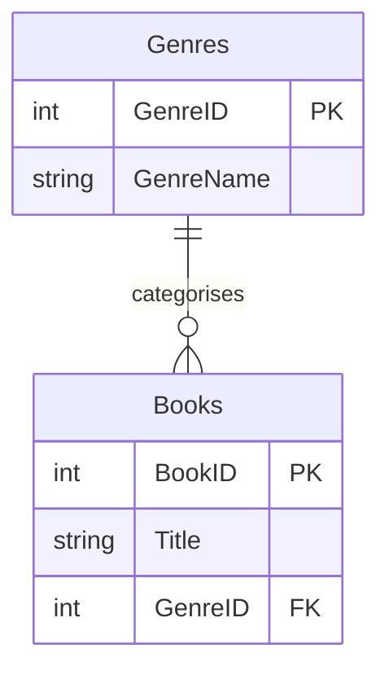

# Day 2 — Database design and stored procedures

6 October 2026

[← Week 3](../README.md) · [Previous notes: SQL joins](day-01-sql-joins.md)

We reviewed the Northwind join questions, then moved on to creating and changing tables. The afternoon covered normalisation, entity relationship diagrams, transactions, stored procedures and `CASE` expressions.

## Explaining technical ideas

In the morning questions, I explained that a join brings together data from related tables so it can be analysed in one result set.

A useful technical answer needs more than a definition. Explain the main characteristics, why the concept is useful and a small example. For joins, that could mean explaining how customer details and order details are stored separately, then showing how they can be queried together.

Another point from the session was to get comfortable checking the documentation. Start with the problem, identify the function or statement that might help, then check its arguments, return type and examples. SQL dialects differ, so the documentation needs to match SQL Server when writing T-SQL.

## Connecting to a database

A connection normally needs a server or host, the relevant port, an authentication method and a database to work in. Authentication might use a username and password or an integrated sign-in method.

`localhost` refers to the machine from which the connection is being made. If SQL Server is running in a container, the connection also depends on how its port is exposed to the host.

A connection string brings the connection settings together. Once connected, `USE Northwind;` changes the database context for subsequent statements; it does not connect to a different server.

## Join exercise review

The full join examples are in [Day 1](day-01-sql-joins.md). Today's review focused on choosing the right tables and making sure the calculations answer the question.

### Discounted order values

In Northwind, `[Order Details].Discount` is stored as a fraction. A value of `0.05` means 5%.

```sql
SELECT
    OrderID,
    SUM(UnitPrice * Quantity * (1 - Discount)) AS OrderTotal
FROM dbo.[Order Details]
GROUP BY OrderID;
```

For a line containing two items at £10 each with a 5% discount:

- Before the discount: `10 * 2 = 20`.
- Discount amount: `10 * 2 * 0.05 = 1`.
- Amount charged: `10 * 2 * (1 - 0.05) = 19`.

Multiplying by `Discount` alone calculates the money taken off, not the final price. Use the price stored on the order line when calculating historical sales, rather than the product's current price.

This query only needs `[Order Details]`. There is no need to join `Orders` unless the question also needs something from the order header, such as the customer, order date or shipper.

### Customer spending and counting orders

To find customer spending, follow the relationships from `Customers` to `Orders` to `[Order Details]`:

```sql
SELECT TOP (5)
    c.CustomerID,
    c.CompanyName,
    COUNT(DISTINCT o.OrderID) AS NumberOfOrders,
    SUM(od.UnitPrice * od.Quantity * (1 - od.Discount)) AS TotalSpend,
    SUM(od.UnitPrice * od.Quantity * (1 - od.Discount))
        / COUNT(DISTINCT o.OrderID) AS AverageOrderValue
FROM dbo.Customers AS c
INNER JOIN dbo.Orders AS o
    ON c.CustomerID = o.CustomerID
INNER JOIN dbo.[Order Details] AS od
    ON o.OrderID = od.OrderID
GROUP BY c.CustomerID, c.CompanyName
ORDER BY TotalSpend DESC, c.CustomerID;
```

An order can contain several products, so joining to its detail rows repeats the order ID. `COUNT(o.OrderID)` would count the joined lines. `COUNT(DISTINCT o.OrderID)` counts the separate orders, which is what the average order value needs.

Grouping by customer ID as well as company name avoids combining different customers who happen to have the same name. These inner joins include customers with matching orders and order lines.

Other points from the review:

- Category revenue follows `Categories → Products → Order Details`.
- “Most popular product” needs a definition: total units sold and number of order lines measure different things.
- Join columns can have different names. The shipper relationship is `Orders.ShipVia = Shippers.ShipperID`.
- A `LEFT JOIN` can produce null values on the unmatched side even if the original table's column is a non-nullable primary key.
- In a grouped query, selected columns outside aggregate functions need to be included in `GROUP BY`. `HAVING` filters groups; it does not remove that requirement.
- An alias labels an expression. `AS TotalSpend` and `AS [Total Spend]` do not change its data type.

## Groups of SQL commands

| Group | Purpose | Examples |
| --- | --- | --- |
| DDL — Data Definition Language | Define or change database structures | `CREATE`, `ALTER`, `DROP`, `TRUNCATE` |
| DML — Data Manipulation Language | Read or change records | `SELECT`, `INSERT`, `UPDATE`, `DELETE` |
| DCL — Data Control Language | Manage access | `GRANT`, `REVOKE`, `DENY` |
| TCL — Transaction Control Language | Control a unit of work | `BEGIN TRANSACTION`, `COMMIT`, `ROLLBACK`, `SAVE TRANSACTION` |

`SELECT` is also sometimes placed in its own category, DQL, for Data Query Language.

CRUD describes the operations on records: create, read, update and delete. Creating a record uses `INSERT`; creating a table uses `CREATE TABLE`.

### DELETE, TRUNCATE and DROP

These have very different effects:

| Statement | Effect |
| --- | --- |
| `DELETE FROM dbo.Films WHERE FilmID = 1;` | Removes the matching row and keeps the table. Without `WHERE`, it removes every row. |
| `TRUNCATE TABLE dbo.Films;` | Empties the table, keeps its structure and resets its identity counter. It has no row-level `WHERE` filter. |
| `DROP TABLE dbo.Films;` | Removes the table itself, including its data. |

`TRUNCATE` does not create a rule for replacing old data or keeping only recent records. In SQL Server it can be rolled back inside a transaction, although restrictions apply, including to tables referenced by foreign keys. See [Microsoft's TRUNCATE TABLE documentation](https://learn.microsoft.com/en-us/sql/t-sql/statements/truncate-table-transact-sql).

## Creating and changing tables

The lesson used a film database to practise DDL. This is a small version of that idea, using fictional data.

```sql
CREATE DATABASE MyDb;
GO

USE MyDb;
GO

CREATE TABLE dbo.Films (
    FilmID INT IDENTITY(1, 1) PRIMARY KEY,
    FilmName NVARCHAR(100) NOT NULL,
    FilmType NVARCHAR(40) NULL,
    PlotSummary NVARCHAR(MAX) NULL
);
```

`dbo` is the schema containing the table. A schema helps organise database objects and distinguish objects with the same name.

`GO` separates batches in tools such as SQL Server Management Studio. It is a client command, not a T-SQL statement and not a transaction commit.

### Column definitions

- `INT` stores whole numbers.
- `NVARCHAR` stores variable-length Unicode text. Use sensible limits for short values; `NVARCHAR(MAX)` is available for longer text such as a plot summary.
- `NOT NULL` requires a value. A column declared `NULL` allows a missing or unknown value.
- `PRIMARY KEY` identifies each row and enforces uniqueness and non-null values.
- `IDENTITY(1, 1)` generates numbers starting at 1 and increasing by 1.

An identity column is not a promise of consecutive numbers: gaps can occur. Identity generation and the primary key constraint do different jobs. See [Microsoft's IDENTITY documentation](https://learn.microsoft.com/en-us/sql/t-sql/statements/create-table-transact-sql-identity-property).

`NULL` is not a data type, zero or an empty string. It represents a missing or unknown value. Test it with `IS NULL` or `IS NOT NULL`.

### Adding a column and inserting data

```sql
ALTER TABLE dbo.Films
ADD ReleaseDate DATE NULL;

INSERT INTO dbo.Films (FilmName, FilmType, PlotSummary, ReleaseDate)
VALUES (
    N'Example Film',
    N'Drama',
    N'A fictional entry for practising SQL.',
    '2026-10-06'
);

SELECT FilmID, FilmName, FilmType, ReleaseDate
FROM dbo.Films;
```

The insert names its columns explicitly and leaves SQL Server to generate `FilmID`. The `N` prefix marks a Unicode string literal.

If an omitted column has a default, SQL Server can use that default. Otherwise, a nullable column can be left null; a required column without a generated or default value needs to be supplied.

To change an existing column definition:

```sql
ALTER TABLE dbo.Films
ALTER COLUMN FilmName NVARCHAR(150) NOT NULL;
```

Existing data must be compatible with the new definition. For example, null values need to be addressed before making a column `NOT NULL`. An existing ordinary column cannot simply be changed into an identity column with `ALTER COLUMN`.

Running `CREATE TABLE` again will fail if the table already exists. Dropping it first would also remove its data, so use `ALTER TABLE` when the intention is to change and preserve an existing table.

## Normalisation

Database normalisation is about organising tables and their dependencies. It is different from normalising numerical values during data preparation.

The aim is to avoid storing the same fact unnecessarily in several places. Repeated facts can cause **update anomalies**: changing one copy while leaving another unchanged creates conflicting data. Poor structure can also make it difficult to insert or delete one fact without affecting another.

### First normal form — 1NF

Each attribute contains a single value for the chosen model, with no repeating groups or lists packed into a cell.

For example, a product row containing `Colour = 'Red, Green'` makes colours awkward to search and maintain separately. A product-colour table can hold one association per row:

| ProductID | Colour |
| --- | --- |
| 1 | Red |
| 1 | Green |
| 2 | Yellow |

Product information such as its name and price can stay in `Products`. The pair `(ProductID, Colour)` can identify each association in this simple example.

### Second normal form — 2NF

A table must already be in 1NF, and its non-key attributes must depend on the whole of each candidate key, not only part of a composite key.

Suppose an order-line table has a key of `(OrderID, ProductID)`:

```text
OrderLines(OrderID, ProductID, ProductName, Quantity)
```

`ProductName` depends on `ProductID` alone. It would be repeated every time that product appeared in another order. Separate the product description from the order-specific information:

```text
Products(ProductID, ProductName)
OrderLines(OrderID, ProductID, Quantity)
```

The quantity belongs to that product on that order, so it depends on the whole order-line key.

### Third normal form — 3NF

A table must already be in 2NF. In the simple cases covered here, non-key attributes should not depend on other non-key attributes.

For example:

```text
Books(BookID, Title, GenreID, GenreName)
```

`BookID` determines the book's genre ID, and `GenreID` determines the genre name. Repeating the name against every book means a genre rename requires several updates.

Separate it into:

```text
Books(BookID, Title, GenreID)
Genres(GenreID, GenreName)
```

`Books.GenreID` becomes a foreign key referencing `Genres.GenreID`. This example assumes one genre per book; multiple genres would need a linking table.

The normal forms build on one another. Higher forms, including BCNF, were mentioned, but the focus was understanding 1NF, 2NF and 3NF.

Normalisation reduces redundant facts and helps maintain consistency. It does not automatically make every query faster or guarantee the smallest database. Retrieving related information can require more joins, so the design also needs to suit how the data will be used.

## Entity relationship diagrams

An **ERD** shows the structure of a database: its entities, attributes, keys and relationships. In a relational implementation, entities are usually represented by tables, with individual rows representing instances.

For the books example:



This design assumes each book has exactly one genre, while a genre can have zero or many books. That is a modelling choice which needs to agree with the actual constraints.

In crow's-foot notation, a circle means zero, a bar means one and the crow's foot means many. The symbols together show the minimum and maximum participation in a relationship.

When reading or drawing an ERD, check:

- What identifies a row in each table?
- Which foreign key points to which primary or unique key?
- Is the relationship one-to-one, one-to-many or many-to-many?
- Can a relationship be missing, or is it required?
- Do the column types and constraints match the intended relationships?

An ERD makes join paths easier to follow. Northwind's `Orders` table has several relationships, but that alone does not make the database a dimensional star schema.

The practical advice was to build the ERD alongside the database and update it when the structure changes. It should help the next person understand the actual database.

## Transactions and ACID

A transaction groups database operations into one unit of work. A transfer between two account balances is a useful example: the debit and credit should succeed together or neither should be kept.

| Property | Meaning |
| --- | --- |
| Atomicity | The transaction succeeds as a whole or its changes are rolled back. |
| Consistency | The transaction preserves the database's rules and constraints. |
| Isolation | The isolation level controls how concurrent transactions interact and what changes they can see. |
| Durability | With normal full durability, committed changes survive a system failure. |

Consistency depends on correctly defined rules; the database cannot infer every business requirement. Isolation has different levels, with trade-offs between concurrency and protection from interference. See [Microsoft's transaction guide](https://learn.microsoft.com/en-us/sql/relational-databases/sql-server-transaction-locking-and-row-versioning-guide?view=sql-server-ver17).

A small rollback example using the practice film table:

```sql
BEGIN TRANSACTION;

UPDATE dbo.Films
SET FilmType = N'Comedy'
WHERE FilmName = N'Example Film';

SELECT FilmID, FilmName, FilmType
FROM dbo.Films
WHERE FilmName = N'Example Film';

ROLLBACK TRANSACTION;
```

The update runs when SQL Server processes it. `COMMIT` would make the transaction's changes permanent; this example uses `ROLLBACK` to discard them. Finish an explicit transaction promptly instead of leaving it open while working on something else.

`SAVE TRANSACTION` creates a savepoint within an active transaction. It is not a permanent backup. Once a transaction is committed, an ordinary `ROLLBACK` cannot undo it later.

Git versions SQL scripts. It does not automatically record or restore the live database's contents. Database backups, recovery and any required history need their own arrangements.

## Stored procedures

A stored procedure is a named set of SQL statements saved in the database. It can accept parameters, return result sets and change data.

Procedures are useful for operations that need to be reused consistently. They also provide a place to manage database logic and control access through permissions. They are not the same as a scalar function used inside an expression.

### Updating a customer's phone number

```sql
USE Northwind;
GO

CREATE PROCEDURE dbo.UpdateCustomerPhone
    @CustomerID NCHAR(5),
    @NewPhone NVARCHAR(24)
AS
BEGIN
    SET NOCOUNT ON;

    UPDATE dbo.Customers
    SET Phone = @NewPhone
    WHERE CustomerID = @CustomerID;
END;
GO
```

Creating the procedure stores its definition; it does not perform the update. `SET NOCOUNT ON` suppresses affected-row count messages.

The following call would change the sample customer's phone value in the practice database:

```sql
EXEC dbo.UpdateCustomerPhone
    @CustomerID = N'ALFKI',
    @NewPhone = N'000-000-0000';
```

`EXEC` and `EXECUTE` are equivalent here. Named arguments make it clear which value goes into each parameter. The `WHERE` clause limits the update to the specified customer; an ID with no match changes no rows.

If the procedure already exists, use `ALTER PROCEDURE` to change its definition. `CREATE PROCEDURE` needs its own batch, which is why the example separates it from `USE` with `GO`. See [Microsoft's stored procedure overview](https://learn.microsoft.com/en-us/sql/relational-databases/stored-procedures/stored-procedures-database-engine).

For a procedure that retrieves a customer's contact name, the customer ID is the input. A `SELECT ContactName ... WHERE CustomerID = @CustomerID` can return the name in a result set; the name does not need to be supplied as another input parameter.

### Parameters and SQL injection

SQL injection happens when untrusted input is treated as part of the SQL command. Parameters help keep data separate from executable SQL.

A stored procedure is not automatically immune. Building dynamic SQL by concatenating input can reintroduce the problem inside the procedure. The update example uses its parameters directly as values. See [OWASP's SQL injection prevention guidance](https://cheatsheetseries.owasp.org/cheatsheets/SQL_Injection_Prevention_Cheat_Sheet.html).

## CASE expressions

`CASE` returns a value according to conditions. SQL Server uses the first matching `WHEN`; `ELSE` gives a fallback. Without an `ELSE`, an unmatched case returns null.

For a shipping example, suppose the rule is **shipped within 10 calendar days, including day 10**:

```sql
SELECT
    OrderID,
    OrderDate,
    ShippedDate,
    CASE
        WHEN ShippedDate IS NULL THEN 'Not shipped'
        WHEN OrderDate IS NULL THEN 'Unknown'
        WHEN DATEDIFF(day, OrderDate, ShippedDate) <= 10 THEN 'On time'
        ELSE 'Overdue'
    END AS ShippingStatus
FROM dbo.Orders;
```

The ten-day threshold is an example rule, not something built into Northwind. `< 10` and `<= 10` treat the boundary differently, so the operator needs to match the requirement. This example assumes the dates are otherwise valid, including shipment not occurring before the order.

Null dates need explicit handling; a comparison involving a null does not become true. The alias names the calculated output column. It does not add a stored column to `Orders`. See [Microsoft's CASE documentation](https://learn.microsoft.com/en-us/sql/t-sql/language-elements/case-transact-sql).

## Dates and calculating age

`DATEDIFF` takes a date part, start date and end date. It counts boundaries of that date part. For example, crossing midnight can count as one day even if only a few minutes have passed, so it is not necessarily a count of complete 24-hour periods. See [Microsoft's DATEDIFF documentation](https://learn.microsoft.com/en-us/sql/t-sql/functions/datediff-transact-sql).

The employee example combined names and estimated age from birth date:

```sql
SELECT
    FirstName + ' ' + LastName AS EmployeeName,
    FLOOR(DATEDIFF(day, BirthDate, GETDATE()) / 365.25) AS ApproximateAge
FROM dbo.Employees;
```

`GETDATE()` returns the current SQL Server system date and time. Dividing by `365.25` gives an approximate number of years, and `FLOOR` rounds down to a whole-number value; its result type is not necessarily `INT`.

This is an estimate, not a reliable exact age calculation around every birthday. `DATEDIFF(year, BirthDate, GETDATE())` alone also needs care because it counts year boundaries without checking whether the birthday has occurred. Exact age needs a calendar-based birthday check and an agreed rule for leap-day births.

The follow-on exercise was to use `CASE` to add a retirement-status label using the exercise's criteria. The threshold and the accuracy required should come from those criteria rather than an assumed retirement age.

## Practice set during the session

The database task brought together creating tables, inserting data and altering the structure, with an ERD developed alongside it. There were also further Northwind query questions and the employee `CASE` exercise.

For the practical work, the useful checks are whether the keys reflect the relationships, whether a join changes the number of rows being counted, and whether boundary cases such as nulls and exact threshold values behave as intended.
