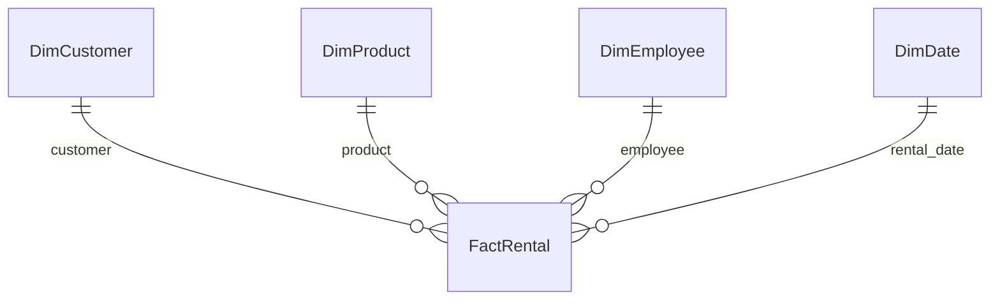
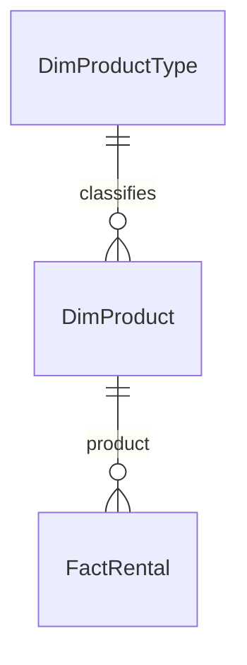

# Day 4 — Dimensional modelling and data storage

8 October 2026

[← Week 3](../README.md) · [Previous notes: Subqueries, query performance and data storage](day-03-subqueries-query-performance-and-data-storage.md)

The morning was used for SQL revision and the SQL Server assessment. After that, we continued with data storage: warehouse architecture, fact and dimension tables, star and snowflake schemas, data lakes and lakehouses. We finished by moving into the Python fundamentals work.

## Working as a consultant

The morning reminder covered four behaviours: delivery, communication, engagement and professionalism.

The practical point was to communicate early if something will not be finished on time. Explain the blocker and what support is needed instead of leaving someone to chase an update. Being able to explain the work also matters: submitting an answer and understanding how it works are different things.

## What makes a data warehouse different?

A data warehouse is designed for analysis and reporting. It brings data together so the business can ask questions across processes, departments and time periods.

During the discussion, I initially described a warehouse in terms of the amount of data and the different systems it could draw from. The useful correction was to focus on **purpose**, not size. An operational database can be larger than a warehouse.

- An operational system might record a rental, update stock availability or retrieve a customer's current order.
- A warehouse might support analysis of rental revenue by product, customer group and month.

The broad comparison is between operational processing and analytical processing. A warehouse is itself a type of database system; “database” does not always mean an operational relational database.

**Data marts** focus on particular subjects or business areas, such as sales, finance or recruitment. They can make the relevant data easier to use for that area's reporting. Their relationship to the central warehouse depends on the architecture.

Warehouses are often designed to preserve history. Calling the data *non-volatile* means it is relatively stable for analysis, rather than constantly overwritten by everyday transactions. It does not mean corrections, controlled updates or retention-based deletion can never happen.

## Inmon and Kimball approaches

These are two influential approaches to warehouse design, rather than the only possible architectures.

| | Inmon | Kimball |
| --- | --- | --- |
| Overall approach | Top down | Bottom up |
| Starting emphasis | An integrated enterprise data model and central warehouse | Business processes and their analytical needs |
| Typical core model | A normalised enterprise warehouse | Dimensional models using facts and dimensions |
| Data marts | Built from the integrated warehouse | Delivered incrementally and integrated through shared definitions |

The **Inmon** approach puts enterprise-wide consistency at the centre. Data from different sources is integrated into the warehouse, from which reporting structures and data marts can be built. That can require substantial coordination and modelling early on.

The **Kimball** approach delivers useful dimensional models a business process at a time. For example, start with sales analysis, then add inventory or another process. This can produce useful reporting sooner, but the pieces still need a common design.

Simply building unrelated departmental marts and joining them later is not enough. **Conformed dimensions** give different fact tables consistent attributes and meanings, so reports can compare their results sensibly. A shared product or date dimension is an example. See [Kimball Group's explanation of conformed dimensions](https://www.kimballgroup.com/data-warehouse-business-intelligence-resources/kimball-techniques/dimensional-modeling-techniques/conformed-dimension/).

Neither approach is automatically cheaper, faster or better in every organisation. Existing systems, reporting needs, governance and delivery constraints affect the choice.

## Facts, dimensions and grain

Dimensional modelling separates the business activity being measured from the context used to describe it.

### Fact tables

A fact table records a business process at a defined level of detail. It usually contains measures and keys linking to the relevant dimensions.

For a sales example, measures might include units sold and sales amount. For rentals, they might include amount paid and rental duration.

The **grain** states what one row represents. An illustrative rental model could use one row per product rental. If one customer transaction contains several products, each product rental would then have its own row.

Define that before deciding which values belong in the table. Mixing individual rental lines with monthly totals would make aggregation confusing and could double-count results. Kimball's design sequence is to identify the business process, declare the grain, then identify the dimensions and facts. See [the four-step dimensional design process](https://www.kimballgroup.com/data-warehouse-business-intelligence-resources/kimball-techniques/dimensional-modeling-techniques/four-4-step-design-process/).

### Dimension tables

Dimensions supply context for filtering, grouping and labelling the facts.

| Dimension | Example context |
| --- | --- |
| Product | Product name, type, model or category |
| Customer | Customer details used in the analysis |
| Employee | The employee associated with the transaction |
| Date | Calendar date, month, quarter and year |

For “rental revenue by product type and month”, the revenue is a measure, while product type and month describe how to group it.

The distinction is about meaning, not just data type. A numeric customer key is not a value to sum, and a date is not an additive measure. Some facts record events without numeric measures at all. Dimension attributes can also change over time, so historical reporting needs an agreed way to handle those changes.

## Star schemas

A star schema places a fact table at the centre, directly related to its dimensions. Descriptive attributes usually stay together within each dimension, keeping the join paths straightforward.

This simplified sketch shows the rental idea:



For this sketch, each rental row references one member of each dimension, while a dimension member may be associated with many rentals. The actual model needs to account for missing or unknown references too.

The shape helps communicate the design, but putting boxes in a star arrangement is not enough. The fact's grain, the keys and the relationships need to make sense.

Star schemas are useful for business intelligence because common questions can follow short, clear joins between facts and descriptive data. See [Microsoft's star schema guidance](https://learn.microsoft.com/en-us/power-bi/guidance/star-schema/).

## Our Blockbuster rental exercise

The group task was to design a star schema for rental reporting, then consider how to turn it into a snowflake schema.

I shared our group's star schema. The feedback was positive about the central rental fact table and its links to product, employee, customer, date and time dimensions. We had separated the measures associated with a rental from the descriptive details around it.

Using names such as `DimProduct` and `DimCustomer` made their roles clear. The prefix is a naming convention, not a requirement of dimensional modelling.

The discussion raised three points worth remembering.

### Use a key for the entity, not every attribute

A customer key identifies the relevant customer dimension row. There is no need for a separate “customer age key” merely to retrieve age already represented in that dimension.

Historical questions also need care. Age today and age at the time of a rental are different values. The model and calculation should match the question being asked.

### Keep planned and actual dates distinct

We discussed whether a rental needs a start date, return date and length of loan when one value may be calculated from the others.

The definitions matter:

- A start date plus the **agreed loan period** can determine a due date, subject to the business's calendar rules.
- An **actual return date** records what happened. It cannot be inferred from the agreed period if the item was returned early or late.
- An actual duration can be calculated from the start and actual return timestamps using an agreed definition of duration.

Avoid storing the same derivable fact without a reason, but do not remove distinct information. Keeping a calculated value can also be a deliberate reporting or performance choice if it is maintained consistently.

### Date and time are a modelling choice

The feedback suggested combining date and time for the simple exercise. Separate date and time dimensions can also be valid when they serve useful reporting needs.

Splitting date and time into two dimensions does not, on its own, turn a star into a snowflake. Snowflaking is about normalising attributes into related tables within a dimension. Choose the time detail the analysis actually needs, rather than splitting a value simply because it can be split.

## Snowflake schemas

A snowflake schema normalises parts of the dimensions into further related tables. The business process in the central fact table stays the same.

The clearest example from the rental task was product type. Instead of repeating the type's details against every product, separate them:

```text
Star:
DimProduct(ProductKey, ProductName, ProductTypeName)

Snowflake:
DimProduct(ProductKey, ProductName, ProductTypeKey)
DimProductType(ProductTypeKey, ProductTypeName)
```

The relationship becomes:



The fact still links to the product. The product links onwards to its type. A similar pattern can apply to a location hierarchy, such as a dealership belonging to a region, which belongs to a country.

| Star | Snowflake |
| --- | --- |
| Keeps descriptive attributes together in wider dimensions | Splits some dimension attributes into related tables |
| Usually has simpler query paths | Usually requires more joins to retrieve the same context |
| Can repeat descriptive information | Can reduce repeated descriptions and centralise their maintenance |

Actual storage and query performance depend on the database engine, compression and workload. More tables do not automatically make a design better.

There is also no fixed rule that “star means 1NF or 2NF” and “snowflake means 3NF”. Normal forms describe dependencies within relations; star and snowflake describe the dimensional layout.

## Spotting poor normalisation

I asked how to recognise poor normalisation in a real company's database. The discussion came back to exploring the data and asking whether repeated information needs to be repeated.

A useful way to approach that is:

1. Establish what one row represents and identify the candidate keys.
2. Look for lists or repeating groups within a field.
3. For composite keys, check whether a non-key attribute depends on only part of the key.
4. Look for non-key attributes that determine other non-key attributes.
5. Ask what happens when a fact is inserted, updated or deleted.

For example, if every order stores the same customer's phone number, a phone-number change could require several updates. A separate customer table can hold that fact once, with orders referencing the customer.

However, repeated values are not automatically a normalisation problem. Several customers can live in the same city. Repeated foreign keys are expected in a one-to-many relationship. A deliberately denormalised reporting dimension can also be appropriate.

A lookup table for a classification, such as the gender example discussed in class, is a design option rather than a mandatory step just because a value repeats. Consider dependencies, business meaning and how the data will be maintained.

### Normalisation versus cleaning

`UK`, `U.K.` and `United Kingdom` representing the same country is primarily a standardisation problem. Agreeing a consistent representation belongs in data cleaning and transformation. A reference table can help enforce that choice, but normalisation alone does not correct inconsistent values.

The recap of the first three normal forms was:

- **1NF:** single values for the chosen model, with no repeating groups.
- **2NF:** 1NF, with no non-key attribute depending on only part of a candidate composite key.
- **3NF:** 2NF, removing transitive dependencies of the kind where one non-key attribute determines another.

The detailed examples are in [Day 2's normalisation notes](day-02-database-design-and-stored-procedures.md#normalisation).

## Reading a larger warehouse model

We looked at a warehouse example with areas such as finance, inventory, sales and currency rates. The useful exercise was to identify a business process, find its fact table, and follow the links to its dimensions.

Sales amount, tax and discount are examples of values associated with sales activity. Product, customer and date details provide the context. A currency-rate fact might instead have a grain such as one currency's rate on one date.

A warehouse can contain several fact tables and subject areas. They do not all need the same grain, and a complex diagram should be understood one process at a time. Related areas can share conformed dimensions.

## Data lakes

A data lake can hold a mixture of data formats, including:

- Structured data such as tabular extracts.
- Semi-structured data such as JSON or XML.
- Unstructured data such as documents, images, audio or video.

It can preserve source data in its original form so that different uses can be explored later. That is useful when the final analytical model is not yet known.

**Schema-on-read** means applying a structure when interpreting the data for use. **Schema-on-write** means applying the target structure and rules as data is written. These describe approaches; real systems can combine them.

A lake can have raw, cleaned and curated areas. It should not be treated as an unorganised pile of files. Catalogues, metadata, naming conventions, access controls and ownership help people find and understand the data. Without those, flexibility becomes difficult to manage. See [Microsoft's data lake overview](https://learn.microsoft.com/en-us/azure/architecture/data-guide/scenarios/data-lake).

### Analysing data from a lake

Data does not always need to be moved into a warehouse before it can be analysed. A suitable query engine or processing tool can work with selected lake data directly.

The preparation depends on the source and the question. It may involve parsing files, checking types, standardising values, combining sources or validating completeness. Raw data is not automatically useless, and data in a lake is not necessarily raw.

Object storage can be economical and scalable, but total cost includes processing, movement and management as well as storage. Warehouses and lakes can run in the cloud or on premises; cloud hosting is not what defines either one.

## ETL, ELT and an extra loading stage

The letters describe the order of operations, not a compulsory choice of storage product.

| Pattern | Example flow |
| --- | --- |
| ETL | Extract sales files → validate and transform → load reporting tables. |
| ELT | Extract source data → load a target's staging area → transform into analytical tables there. |
| ELTL | Extract source files → load a raw lake area → transform → load a separate reporting destination. |

The extra `L` in the last example represents another loading step after transformation. A pipeline may have several such stages rather than fitting neatly into a single acronym.

A data lake is useful for loading varied source files before deciding how to transform them. However, **ELT also works with data warehouses**. The source can first be loaded into a supported staging structure, then transformed using warehouse compute. The data still needs to meet the destination's ingestion requirements. AWS describes this pattern with Amazon Redshift in its [data-processing guidance](https://docs.aws.amazon.com/whitepapers/latest/data-warehousing-on-aws/data-processing.html).

Missing values also need business rules. They might be valid, rejected, investigated or represented as unknown; a transformation step should not invent values simply to eliminate every null.

## Data lakehouses

A lakehouse combines flexible lake storage with capabilities commonly associated with warehouses, such as managed tables, schema controls and reliable analytical querying.

It is more than placing an unrelated warehouse next to a lake. Table formats and management layers can provide transaction support and governed access over data in lake storage. For example, Microsoft's Fabric lakehouse uses Delta Lake tables for features including ACID transactions and schema enforcement. See [Microsoft's lakehouse overview](https://learn.microsoft.com/en-us/fabric/data-engineering/lakehouse-overview).

A lakehouse does not require the Kimball approach, though its curated reporting tables can use dimensional models. The architecture and the analytical model are different decisions.

The attraction is supporting several uses of data, including engineering, reporting and data science, with less unnecessary copying. It still needs clear ownership and quality rules: users need to know which data is raw, which has been checked and which is approved for reporting.

## Comparing the storage choices

| Storage approach | Main emphasis | Example use |
| --- | --- | --- |
| Operational database | Reliable day-to-day application operations | Record a rental and update availability. |
| Data warehouse | Integrated data for analysis and reporting | Compare revenue by product and month. |
| Data lake | Flexible storage of varied data for current and future processing | Retain source extracts, logs and documents. |
| Data lakehouse | Managed analytical tables and processing on lake storage | Use a shared platform for preparation, analysis and reporting. |

These can work together. The useful starting questions are what the data looks like, who needs it, which operations they perform, and what reliability, cost and governance requirements apply.

AI tools may help search or process data, but they do not remove the need for metadata, access controls and validation. Engineers, analysts and data scientists can have overlapping responsibilities; the division depends on the team and the work.

## Starting Python fundamentals

The next work was the Python fundamentals course and the functions and control-flow worksheets. The emphasis was on being able to solve and explain the problems, including why the code works, rather than only producing an answer.

I asked whether we needed the Python extension in VS Code. The trainer's preferred environment for the Python sessions was PyCharm, although it was not mandatory. The version guidance given for the training was Python 3.11 or newer.

The broader point was that the concepts carry across editors. Using a different IDE changes the interface and setup, but functions and control flow still need to be understood. Additional labs and coding challenges were available for further practice.
